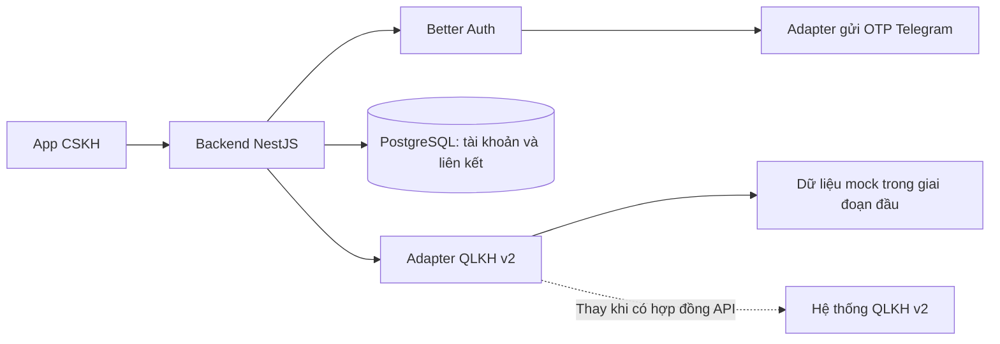

# Yêu cầu và hướng triển khai app CSKH cấp nước

## Phạm vi

App CSKH dành cho người sử dụng nước; hệ thống QLKH v2 dành cho công ty cấp nước
và cung cấp dữ liệu khách hàng cấp nước.

Các chức năng cần triển khai:

- Đăng ký tài khoản bằng số điện thoại, xác thực OTP qua Telegram.
- Liên kết khách hàng cấp nước bằng mã khách hàng và số điện thoại.
- Xem hóa đơn, lịch sử và biểu đồ sử dụng nước.
- Thanh toán hóa đơn bằng QR và theo dõi kết quả thanh toán.
- Kết nối QLKH v2 qua API; dùng API mock trong khi chờ API thật.

Đăng ký tài khoản app và liên kết khách hàng cấp nước là hai bước riêng.
Tài liệu mô tả yêu cầu, luồng dữ liệu và thứ tự triển khai; các điểm chưa chốt
cần thống nhất với đơn vị cấp nước trước khi tích hợp thật.

## 1. Tài khoản app

Người dùng đăng ký bằng tên, số điện thoại và mật khẩu. Hướng hoàn thiện là nhận
OTP qua Telegram để xác nhận đăng ký; đăng nhập bằng số điện thoại và mật khẩu.
Không yêu cầu OTP mỗi lần đăng nhập ở giai đoạn này.

Backend dùng plugin phoneNumber để xác minh OTP khi đăng ký và đăng nhập bằng
số điện thoại/mật khẩu. Phần gửi mã qua Telegram cần nối vào otpSender.send;
không tự đánh dấu tài khoản cũ đã xác thực.

Telegram yêu cầu chia sẻ contact của chính người gửi trong private chat trước
khi yêu cầu OTP. Chi tiết thời hạn và giới hạn nằm trong [AUTH-TELEGRAM.md](AUTH-TELEGRAM.md).
Chỉ chuyển dữ liệu tối thiểu cần để gửi OTP; không chuyển mật khẩu cho bot.
Phải xác định cách đối chiếu số điện thoại trước khi bật liên kết dữ liệu thật.

## 2. Liên kết khách hàng cấp nước

Một tài khoản app có nhiều liên kết, ví dụ Nguyễn Văn A liên kết hai mã
`01030001` và `01030002`. Mã khách hàng là chuỗi, giữ nguyên số 0 đầu.
Không gộp tài khoản app và khách hàng v2 vào cùng một bản ghi.

1. Người dùng đăng nhập và nhập mã khách hàng từ hóa đơn.
2. Backend lấy ID tài khoản từ session và số điện thoại từ hồ sơ đã lưu.
   Không nhận ID tài khoản hoặc số điện thoại tùy ý để xác nhận quyền truy cập.
3. Backend gửi mã khách hàng và số điện thoại sang adapter v2.
4. V2 đối chiếu. Không khớp thì từ chối liên kết; không trả thông tin người khác.
5. Khớp thì backend lưu liên kết với ID/mã khách hàng do v2 trả về.
6. App hiển thị danh sách khách hàng đã liên kết. Gửi lại cùng yêu cầu không
   tạo liên kết trùng. Không có bước nhân viên duyệt thủ công.

Nếu v2 lỗi hoặc hết thời gian chờ thì báo thử lại, không tự xem là xác nhận hợp lệ.
Quy tắc một khách hàng v2 có được nhiều tài khoản app liên kết hay không cần
thống nhất với đơn vị cấp nước trước khi áp dụng ràng buộc toàn hệ thống.

## 3. Hóa đơn và lịch sử

Đã có API `GET /invoices/unpaid` dùng dữ liệu mock, tổng hợp hóa đơn chưa thanh
toán của tài khoản đang đăng nhập. Liên kết khách hàng hiện được mô phỏng theo
cấu hình server; chưa kết nối v2. Xem [UNPAID-INVOICES.md](UNPAID-INVOICES.md)
để biết luồng dữ liệu, hợp đồng API và cách kiểm tra.

Người dùng chọn một khách hàng đã liên kết. Backend kiểm tra quyền trước khi lấy
hóa đơn từ v2. Không cho phép truy vấn tùy ý mã khách hàng của người khác.

Hóa đơn gồm kỳ, số tiền, trạng thái và số liệu tiêu thụ nếu v2 cung cấp.
Lịch sử theo tháng trả dữ liệu cho frontend vẽ biểu đồ; tháng thiếu dữ liệu không
mặc định là sử dụng 0 m³. Cần thống nhất với v2 về đơn vị, kỳ và phân trang.

## 4. Thanh toán

Người dùng chọn hóa đơn chưa thanh toán. Backend kiểm tra quyền và số tiền từ
nguồn dữ liệu, tạo yêu cầu thanh toán rồi trả dữ liệu QR cho app.

App chỉ báo thành công và về trang chủ sau khi backend xác nhận trạng thái.
Việc hiển thị/quét QR không phải bằng chứng đã thanh toán. Trong bản mock,
trạng thái là mô phỏng; không sinh yêu cầu chuyển tiền thật.

Khi tích hợp thật cần thống nhất callback hoặc cách tra cứu trạng thái,
xác thực bên gửi kết quả và xử lý thông báo trùng. Không cho app tự đặt trạng
thái đã thanh toán trong môi trường thật.

## 5. Nguyên tắc code

- Domain: kiểu dữ liệu và quy tắc nghiệp vụ, không gọi HTTP hoặc database.
- Application: các use case nhỏ, phụ thuộc port của repository hoặc v2.
- Infrastructure: TypeORM, client HTTP, adapter mock, Telegram.
- Presentation: controller/DTO, session, mã HTTP và response EC/EM.
- Module: nối dependency injection. Chỉ bổ sung framework hoặc tách microservices
  khi có nhu cầu cụ thể.
- Giữ tên rõ nghĩa, xử lý tuần tự, tách hàm khi có trách nhiệm riêng.
- Không tạo test spec mới theo yêu cầu người dùng; dùng kiểm tra hiện có và
  kiểm tra trực tiếp các luồng thay đổi.

## 6. Sơ đồ luồng dữ liệu đề xuất

Frontend chỉ gọi backend CSKH. Thông tin xác thực với v2 nằm ở backend.
Không để app truy cập trực tiếp database hoặc cầm khóa kết nối của công ty cấp nước.

## 7. Hợp đồng API cần mô tả

Các đường dẫn dưới đây là **đề xuất thiết kế**, không phải danh sách endpoint đã có.
Tên trường và đường dẫn phía v2 phải thống nhất với đội cấp nước trước khi tích hợp.

| API app → backend đề xuất           | Mục đích                 | Dữ liệu chính                        |
| ----------------------------------- | ------------------------ | ------------------------------------ |
| POST /auth/register/otp             | Xin OTP đăng ký          | phoneNumber                          |
| POST /auth/register                 | Hoàn tất đăng ký         | userName, phoneNumber, password, otp |
| POST /auth/login                    | Đăng nhập                | phoneNumber, password                |
| POST /auth/logout                   | Đăng xuất                | Cookie session                       |
| POST /customer-links                | Liên kết một khách hàng  | customerCode; userId lấy từ session  |
| GET /customer-links                 | Danh sách đã liên kết    | Lọc theo người đang đăng nhập        |
| GET /customer-links/:id/invoices    | Hóa đơn theo khách hàng  | status, kỳ, phân trang               |
| GET /customer-links/:id/consumption | Tiêu thụ nước theo tháng | Khoảng thời gian                     |
| POST /payments                      | Tạo yêu cầu thanh toán   | linkId và invoiceIds                 |
| GET /payments/:id                   | Kiểm tra kết quả         | Quyền sở hữu yêu cầu thanh toán      |

Mỗi API cần ghi: mục đích, xác thực, request/response mẫu, mã lỗi, giới hạn,
nguồn dữ liệu và cách xử lý khi hệ thống ngoài không phản hồi. Dùng OpenAPI để
frontend và đội v2 dễ trao đổi; không cần viết test spec mới.

Hợp đồng **backend CSKH → v2** cần thống nhất riêng:

1. Đối chiếu mã khách hàng + số điện thoại, trả ID/mã và thông tin tối thiểu.
2. Lấy danh sách hóa đơn và dữ liệu tiêu thụ của khách hàng đã xác nhận.
3. Lấy hoặc tạo dữ liệu QR thanh toán theo cơ chế của đơn vị cấp nước.
4. Nhận hoặc tra cứu trạng thái thanh toán, xử lý callback trùng và đến muộn.
5. Xác thực dịch vụ, phân quyền, timeout, mã lỗi và giới hạn gọi API.

Không tự quyết định v2 dùng API key, OAuth hay chữ ký HMAC khi chưa biết hợp đồng.
Có thể mô tả các lựa chọn để đội v2 chốt; adapter mock phải có dữ liệu và lỗi mẫu
cùng cấu trúc dự kiến để sau này thay adapter mà không sửa nghiệp vụ.

## 8. Thứ tự tự triển khai

1. **Chốt luồng và dữ liệu:** thống nhất tài khoản app, khách hàng v2, bảng liên kết;
   ghi rõ chức năng nào mock và chức năng nào dùng thật.
2. **Auth:** hoàn thiện đăng ký OTP Telegram và giữ đăng nhập bằng mật khẩu.
   Đầu ra: người dùng đăng ký, đăng nhập, xem hồ sơ và đăng xuất được.
3. **Liên kết khách hàng:** viết port v2 và adapter mock. Ví dụ cùng số điện thoại
   khớp hai mã `01030001`, `01030002`; thêm trường hợp không khớp và v2 lỗi.
   Đầu ra: một tài khoản lưu được hai liên kết, không xem được liên kết của người khác.
4. **Hóa đơn và lịch sử:** lấy dữ liệu qua liên kết, có trường hợp không có hóa đơn,
   nhiều hóa đơn và thiếu số liệu tháng. Frontend dùng dữ liệu đó vẽ biểu đồ.
5. **Thanh toán mock:** chọn hóa đơn, trả QR/dữ liệu giả lập và theo dõi trạng thái.
   Hiển thị rõ mô phỏng; không yêu cầu người dùng chuyển tiền thật.
6. **Tích hợp thật:** thay adapter sau khi đội v2 cung cấp API, thông tin kết nối,
   môi trường thử và cơ chế thông báo thanh toán. Cập nhật OpenAPI theo hợp đồng chốt.

Không cần tách microservices để bắt đầu. Một backend NestJS chia module rõ ràng
đủ cho phạm vi hiện tại.

## 9. Những câu cần hỏi đơn vị cấp nước

- V2 dùng mã khách hàng hay ID nội bộ làm khóa ổn định giữa hai hệ thống?
- Số điện thoại chưa khớp hoặc đã đổi thì xử lý theo quy trình nào?
- Một mã khách hàng có được nhiều tài khoản app liên kết không?
- Hóa đơn và chỉ số tiêu thụ lấy ở API nào, đơn vị và kỳ tính ra sao?
- Cho thanh toán từng hóa đơn hay gộp nhiều hóa đơn trong một giao dịch?
- Ai tạo QR, ai xác nhận đã thu tiền, callback/tra cứu và xác thực ra sao?
- Có môi trường thử, thông tin xác thực và dữ liệu mẫu cho CSKH không?

## 10. Bộ tài liệu nên bàn giao

- Tài liệu này: phạm vi, luồng giao diện tới dữ liệu, thứ tự làm và điểm chưa chốt.
- [AUTH-TELEGRAM.md](AUTH-TELEGRAM.md): phương án auth/OTP và cấu hình dự kiến.
- Hợp đồng OpenAPI sau khi chốt request/response; phân biệt API app với API v2.
- [specs/DECISIONS.md](specs/DECISIONS.md): các quyết định kiến trúc đã áp dụng.

Bộ tài liệu cần mô tả rõ luồng giao diện, đường đi dữ liệu, kết nối, bảo mật
và API mock để phối hợp với đội cung cấp API.
