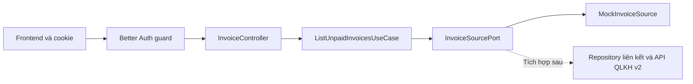

# Danh sách hóa đơn chưa thanh toán

## Phạm vi và nghiệp vụ

Người dùng đã đăng nhập xem hóa đơn chưa thanh toán của tất cả khách hàng cấp
nước đã liên kết với tài khoản. Một tài khoản có thể liên kết nhiều mã khách hàng.
Mã khách hàng là chuỗi để giữ số 0 đầu. Đăng ký app không tự tạo liên kết thật.
Mỗi liên kết đại diện một điểm cấp nước, gồm linkId, servicePointId, mã khách
hàng, tên gợi nhớ, địa chỉ cấp nước và mã đồng hồ. Một người có hai căn nhà sẽ
có hai liên kết, không phải hai tài khoản app. Tên người đứng hóa đơn không được
dùng để xác định quyền truy cập.

Mock hiện mô phỏng cùng chủ hợp đồng `Nguyen Van An (mock)` tại Nhà 1 và Nhà 2.
Đây không phải tên tự lấy từ hồ sơ tài khoản. Mã điểm cấp nước là khóa riêng:
không giả định mã khách hàng luôn tương ứng duy nhất với một đồng hồ trong v2.

API hiện dùng dữ liệu mock vì chưa có API QLKH v2 và module liên kết khách hàng.
Liên kết mock được cấu hình bằng ID tài khoản ở server, không lấy từ frontend.
Không dùng kết quả mock để yêu cầu chuyển tiền. Chưa có tạo QR, thanh toán,
lịch sử hoặc cập nhật trạng thái hóa đơn trong chức năng này.

Quy tắc:

- Chỉ trả trạng thái `UNPAID`, gồm cả hóa đơn quá hạn và chưa đến hạn.
- Không trả hóa đơn `PAID` hoặc `CANCELLED`.
- Chỉ đọc các mã khách hàng thuộc tài khoản lấy từ session.
- Sắp xếp hạn thanh toán tăng dần, sau đó theo invoiceId để phân trang ổn định.
- Không có liên kết hoặc không có nợ: trả 200 với danh sách rỗng.
- Số tiền là số nguyên VND. Tổng tiền là tổng mọi hóa đơn chưa thanh toán
  thuộc tài khoản, không chỉ các hóa đơn của trang hiện tại.

## Luồng giao diện và dữ liệu

1. Người dùng mở màn hình Hóa đơn chưa thanh toán sau đăng nhập.
2. Frontend gọi `GET /invoices/unpaid` kèm cookie session.
3. Guard Better Auth kiểm tra đăng nhập; DTO kiểm tra page và limit.
4. Controller lấy userId từ session, chuyển cho use case.
5. Use case lấy các liên kết đã xác nhận của userId. Nếu có linkId, kiểm tra
   liên kết đó thuộc tài khoản trước khi lấy hóa đơn.
6. Nguồn dữ liệu trả hóa đơn của các điểm cấp nước đó. Use case kiểm tra lại điểm cấp nước và mã khách hàng,
   lọc UNPAID, sắp xếp, tính tổng và phân trang.
7. Controller trả EC/EM và dữ liệu. Giao diện hiển thị mã khách hàng, kỳ,
   hạn thanh toán, lượng nước, số tiền và tổng nợ; hiển thị rõ dữ liệu mô phỏng.



## API app → backend

`GET /invoices/unpaid?page=1&limit=20`

Không gửi body, userId, số điện thoại hay mã khách hàng. Có thể gửi linkId để chọn
một nhà từ danh sách customerLinks của tài khoản. Xác thực bằng cookie
nhận khi đăng nhập. Query lạ bị từ chối bởi ValidationPipe.

| Tham số | Mặc định | Giới hạn |
| --- | --- | --- |
| page | 1 | Số nguyên từ 1 đến 1000000 |
| limit | 20 | Số nguyên từ 1 đến 100 |
| linkId | Không có: xem tất cả | Chuỗi dài 1–100 ký tự, phải thuộc tài khoản |

Ví dụ response khi gọi `?page=1&limit=1` bằng tài khoản mock:

```json
{
  "EC": 1,
  "EM": "Get unpaid invoices successfully",
  "source": "mock",
  "data": {
    "selectedLinkId": null,
    "customerLinks": [
      {
        "linkId": "mock-home-1",
        "servicePointId": "SP001",
        "customerCode": "01030001",
        "label": "Nhà 1",
        "serviceAddress": "12 Nguyễn Trãi (địa chỉ mẫu)",
        "meterNumber": "DH001"
      },
      {
        "linkId": "mock-home-2",
        "servicePointId": "SP002",
        "customerCode": "01030002",
        "label": "Nhà 2",
        "serviceAddress": "35 Lê Lợi (địa chỉ mẫu)",
        "meterNumber": "DH002"
      }
    ],
    "summary": {
      "totalInvoices": 3,
      "totalUnpaidAmount": 350000,
      "currency": "VND"
    },
    "pagination": {
      "page": 1,
      "limit": 1,
      "totalPages": 3
    },
    "invoices": [
      {
        "invoiceId": "MOCK-001",
        "customerName": "Nguyen Van An (mock)",
        "property": {
          "linkId": "mock-home-1",
          "servicePointId": "SP001",
          "customerCode": "01030001",
          "label": "Nhà 1",
          "serviceAddress": "12 Nguyễn Trãi (địa chỉ mẫu)",
          "meterNumber": "DH001"
        },
        "billingPeriod": "2026-09",
        "dueDate": "2026-10-15",
        "consumptionM3": 12,
        "amount": 120000,
        "currency": "VND",
        "status": "UNPAID"
      }
    ]
  }
}
```

`billingPeriod` có dạng YYYY-MM, `dueDate` dạng YYYY-MM-DD, `consumptionM3`
là lượng nước tiêu thụ theo m³. Số tiền mock có sẵn, không phải công thức giá nước.
Trang vượt cuối trả invoices rỗng nhưng giữ tổng số hóa đơn và tổng tiền.
Không có nợ trả summary.totalInvoices, pagination.totalPages và
summary.totalUnpaidAmount bằng 0. Danh sách nằm trong data.invoices;
thông tin tổng hợp nằm trong data.summary, phân trang nằm trong data.pagination.

Response còn có `data.customerLinks` để frontend dựng bộ chọn nhà,
`data.selectedLinkId` (null nếu xem tất cả). Mỗi hóa đơn có
`property` chứa thông tin nhà, địa chỉ, mã đồng hồ. Tổng tiền và phân trang
tính theo phạm vi đang chọn; customerLinks luôn gồm mọi liên kết của tài khoản,
kể cả điểm cấp nước không có nợ. Mã đồng hồ trong liên kết là thông tin hiện tại;
khi tích hợp v2 cần bổ sung mã đồng hồ lịch sử trên hóa đơn nếu có thay đồng hồ.

| HTTP | Ý nghĩa |
| --- | --- |
| 200 | Lấy danh sách thành công, kể cả danh sách rỗng |
| 400 | Query không hợp lệ hoặc có trường không được phép |
| 401 | Thiếu session hoặc session hết hạn; lỗi do guard trả |
| 404 | linkId không tồn tại hoặc không thuộc tài khoản; trả cùng thông báo |
| 503 | Chạy production nhưng chưa cấu hình nguồn hóa đơn thật |
| 500 | Lỗi ngoài dự kiến; không trả chi tiết nội bộ |

## Cấu trúc code

Tất cả nằm trong `src/modules/invoices/`:

- `domain/invoice.ts`: kiểu dữ liệu hóa đơn.
- `application/ports/invoice-source.port.ts`: hợp đồng lấy liên kết và hóa đơn.
- `application/use-cases/list-unpaid-invoices.use-case.ts`: phân quyền theo mã
  liên kết, lọc, sắp xếp, tính tổng và phân trang.
- `infrastructure/mock-invoice-source.ts`: liên kết và hóa đơn mẫu.
- `presentation/dtos/list-invoices.dto.ts`: kiểm tra query.
- `presentation/controllers/invoice.controller.ts`: session, HTTP và EC/EM.
- `invoice.module.ts`: nối dependency injection; AppModule nạp module này.

## Chạy thử bằng Postman

1. Đăng nhập bằng tài khoản app có sẵn, giữ cookie trong Postman.
2. Gọi `GET /users/me`, lấy userId.
3. Điền `MOCK_INVOICE_USER_ID=<userId>` vào `.env`, khởi động lại backend.
   Không điền số điện thoại. Không dùng cấu hình này trong production.
4. Gọi `GET /invoices/unpaid?page=1&limit=2`: có 2 phần tử, summary.totalInvoices = 3,
   summary.totalUnpaidAmount = 350000. Trang 2 có hóa đơn còn lại.
5. Dùng tài khoản khác: danh sách rỗng. Bỏ cookie: 401.
6. Thử page=0, limit=101 hoặc thêm userId: 400.
7. Gọi `GET /invoices/unpaid?linkId=mock-home-1`: 2 hóa đơn, tổng 270000 VND.
8. Gọi `GET /invoices/unpaid?linkId=mock-home-2`: 1 hóa đơn, tổng 80000 VND.
9. Dùng tài khoản khác gọi linkId trên hoặc nhập mã không tồn tại: 404.

Không cấu hình MOCK_INVOICE_USER_ID thì mọi tài khoản nhận danh sách rỗng.
Mock không ghi database và không tự liên kết khách hàng thật.
Kiểm tra tự động nằm trong bài tích hợp có sẵn `test/auth.integration.mjs`;
chạy `npm run test:auth`. Bài kiểm tra dùng PostgreSQL thật và giả lập gửi OTP.

## Kết nối QLKH v2 sau này

Cần thống nhất endpoint, thông tin xác thực, timeout, phân trang, các trạng thái
hóa đơn, đơn vị tiền và cấu trúc lỗi với đội v2. Chưa giả định cơ chế API key
hay OAuth. Khóa kết nối chỉ nằm ở backend.

Thay provider INVOICE_SOURCE bằng adapter thật: lấy các liên kết đã xác nhận từ
database CSKH rồi gọi API v2 theo mã khách hàng đó. Cập nhật source của response.
Không nhận quyền sở hữu từ dữ liệu frontend. Khi v2 lỗi, trả lỗi dịch vụ phù hợp,
không trả danh sách rỗng khiến người dùng hiểu nhầm đã hết nợ.

Hiện use case lấy toàn bộ hóa đơn được cấp quyền trước khi phân trang trong bộ
nhớ, phù hợp dữ liệu mock. Khi tích hợp thật cần đẩy lọc/phân trang và tính tổng
sang nguồn dữ liệu, bảo đảm tổng nợ không chỉ tính trên một trang trả về từ v2.
